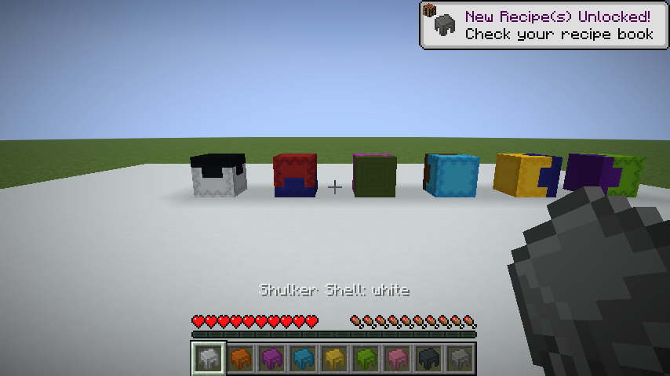
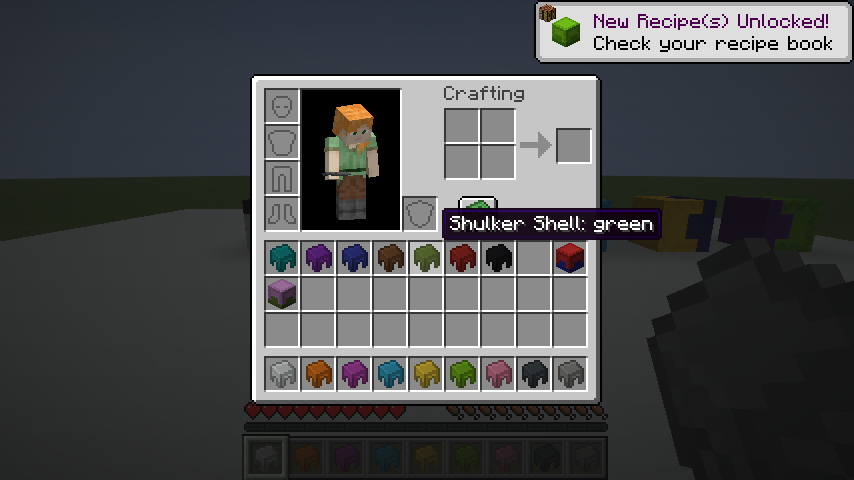
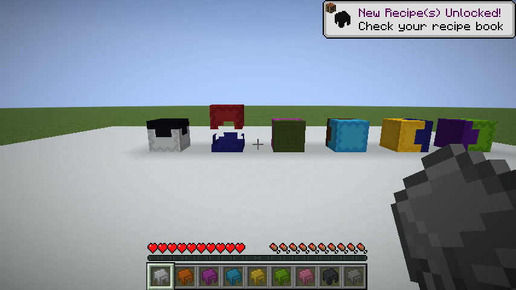

# Bicolor Shulkerboxes

Pick a different color for the lid and the base of your shulker boxes.

Dye your shells, mix your favorite colors, and give each box its own look. All 16 dyes and the natural shulker color are supported.

## How to craft

- **Shell + dye** → a colored shell. You can dye it again whenever you like.
- **Shell / chest / shell**, stacked vertically → a shulker box. The top shell colors the lid; the bottom shell colors the base.
- **Box + dye** → a single-color box, keeping everything inside.

Use a crafting table or automate the recipes with a crafter. Matching shells give you a regular single-color box.

The shells keep their original Minecraft texture, and boxes open just as usual.

## Installation

For **Minecraft Java 1.21.11** with **Fabric** and **Fabric API**.

[Download the mod](https://github.com/ShamanTramp/Bicolor-Shulkerboxes/releases/latest) and drop the `.jar` into your `mods` folder. Install it on your client for singleplayer, or on your server for multiplayer.

### Playing with friends

Players can join your server without installing the mod. They'll see regular boxes in their base color, with a tooltip showing both colors.

Install the mod on your client to see the colored shells and bicolor boxes. **The same `.jar` works on both sides.** No separate resource pack is needed.

[Report a bug](https://github.com/ShamanTramp/Bicolor-Shulkerboxes/issues) · [Developer documentation](docs/DEVELOPMENT.md)
